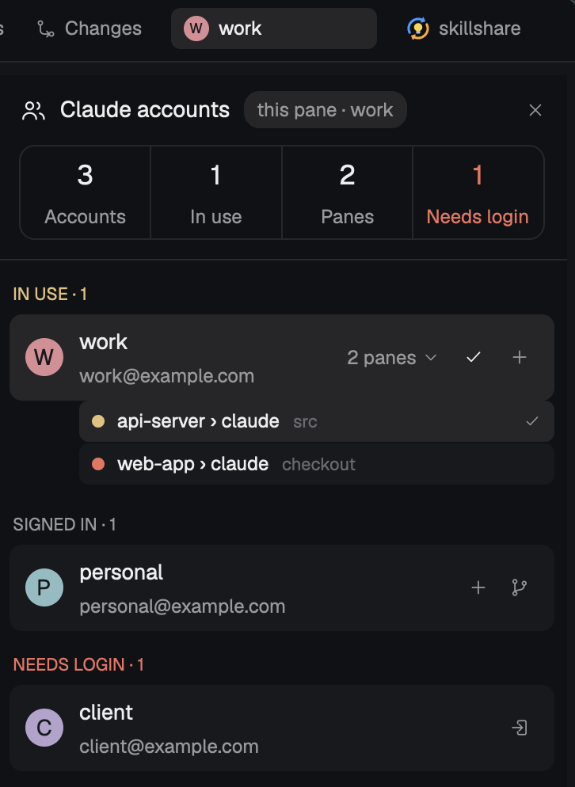

# herdr-cc-accounts

 



Claude Code accounts side by side in Herdr.app. Each pane opens already in the account you choose, accounts run at the same time, and a button in the tab bar opens a side panel that shows which account the focused pane uses, which accounts are in use, which panes use each one and which accounts need a login.

Switching with `/login` changes the account for the whole machine. Here every account has its own `CLAUDE_CONFIG_DIR`, so the choice belongs to one process.

## How it works

- The **default account** is the one you already have: `~/.claude`, with `CLAUDE_CONFIG_DIR` unset.
- Every other account is a folder, `~/.claude-accounts/<name>/`. The filesystem is the registry: there is no config file that can drift.
- Claude Code keeps each folder's login in its own credential store (on macOS, a Keychain item whose name carries a hash of the folder; see "How it is known" below). The login itself is never read or copied: no token, no credential file, no Keychain item is touched. One thing does travel, though: the `mcpServers` replicated from `~/.claude.json` can carry secrets in their `env` or `headers`, and they are written into each account's `.claude.json` (mode 0600). Treat every account folder as holding the same MCP secrets as `~/.claude.json`.
- What is yours rather than the account's (skills, agents, commands, hooks, plugins, output styles, `CLAUDE.md`, `settings.json`, `keybindings.json`) is shared by symbolic links to `~/.claude`.
- History (`projects`, `plans`, `todos`, `file-history`, `shell-snapshots`, `history.jsonl`) is linked too, so `--resume` finds a conversation started in any account.
- Account state (`.credentials.json`, `.claude.json`, `sessions`, caches and the rest of the runtime) is never linked.
- From `~/.claude.json`, each account's own `.claude.json` receives the top-level `mcpServers` and, for each project, `mcpServers`, `allowedTools`, `hasTrustDialogAccepted`, `enabledMcpjsonServers` and `disabledMcpjsonServers`. The rest of the account's file is kept as it is. The merge is a union: an MCP server you remove from the default account does not disappear from the other accounts. Remove it there too. `allowedTools`, `enabledMcpjsonServers` and `disabledMcpjsonServers` are unions as well, with the default account's entries first, no duplicates, and whatever only the account has kept at the end. A permission you revoke in the default account therefore stays in the others until you revoke it there too. `hasTrustDialogAccepted` never goes from true back to false.

The table that decides all of this is one object, `SHARING`, at the top of `mods/cc-accounts/cli.js`.

## Requirements

Node 22 or newer (older versions are not tested), Claude Code (`claude` on `PATH`) and Herdr.app. `cc-accounts which` reads a process environment with `ps -E`, which is the macOS form; elsewhere it answers `unknown`.

## Install

### From the Herdr gallery

The mod is the folder `mods/cc-accounts/`. Copy it to `~/.config/herdr-app/mods/cc-accounts/`, which is what an agent does when you ask Herdr for it, and merge `keys.json` into `~/.config/herdr-app/keys.json`. The CLI lives in that folder too, as `mods/cc-accounts/cc-accounts`, and the mod runs it by that path, so nothing else needs to be on your `PATH`. To use the CLI from a terminal, link it:

```sh
ln -s ~/.config/herdr-app/mods/cc-accounts/cc-accounts ~/.local/bin/cc-accounts
```

The mod runs programs and reads files outside its own folder. "What it reads and writes outside the repo" below lists all of them.

### From this repository

```sh
./install.sh            # link, mod and key
./install.sh --layout   # the same, then the tab-bar button and the panel in the shown layout
./install.sh --remove   # only take the button and the panel out of the shown layout again
```

In this order, the script:

1. Checks that `ctrl-shift-a` is free in `~/.config/herdr-app/keys.json`, comparing keys regardless of modifier order. If another action holds it, it aborts without touching anything.
2. Aborts if `~/.config/herdr-app/mods/cc-accounts` exists and is not this mod (a real folder whose `mod.json` has the title "Claude Code accounts"), or if `~/.local/bin/cc-accounts` already exists and is neither a link to the installed CLI nor the link an older layout of this repository made (`bin/cc-accounts`, which is replaced).
3. Copies `main.js`, `model.js`, `cli.js`, `cc-accounts`, `mod.json` and the `icons/` folder of `mods/cc-accounts/` to `~/.config/herdr-app/mods/cc-accounts`, and removes the `accounts.svg` of an older version. It is a copy, not a link: after changing the repo, run `./install.sh` again. `RECIPE.md` and `preview.png` stay out.
4. Links `~/.local/bin/cc-accounts` to the CLI in that folder, so the terminal and the mod run the same file.
5. Backs up `keys.json` as `keys.json.bak-<epoch in ms>-<6 random hex digits>` (never over an existing backup) and adds `"ctrl-shift-a": "mod.open:cc-accounts"` under `global`. If `keys.json` is a symbolic link, the file it points to is edited in place and keeps its mode.

   Herdr's documentation says that once you edit `keys.json`, new default shortcuts that later Herdr versions add stop arriving on their own, because the file is then yours. Check Herdr's release notes after an update, or compare with a fresh `keys.json`.

If the key cannot be written (for example the Herdr folder is read-only), it aborts with a message and a non-zero exit. Running it again changes nothing and makes no extra backup. `HOME` and `HERDR_APP_HOME` are honored, so you can try it against throwaway folders.

Then create your accounts:

```sh
cc-accounts add work
cc-accounts add personal
```

In each new account, open a tab with `cc-accounts run <name>` and use `/login`. The panel can do both steps for you: see [Adding an account from the panel](#adding-an-account-from-the-panel).

### The toggle button and the panel

`./install.sh --layout` runs `scripts/place-layout.mjs apply` on the layout Herdr is showing (the `layout` key of `~/.config/herdr-app/shared.json`; `HERDR_APP_HOME` is honored). It adds two nodes, and only these:

- `cc-accounts-toggle`, a 140 px block in the row that holds the `tabs` block, right before a `skillshare-toggle` if there is one, else at the end of the row. It shows a round 16 px avatar with the initial of the account of the focused pane, in a color picked from the theme's `ansi1` to `ansi6` by the account's name (the same account always gets the same color), and the account's name beside it. When the focused pane is not running a local Claude it shows a generic accounts icon and `Accounts`. A long name ends in an ellipsis. The button has the "on" look of the skillshare button while the panel is open, and a tooltip with the account's status. Clicking it runs `layout.toggle` on the panel. An older 150 px toggle written by this script is resized by the next `--layout`.
- `cc-accounts-panel`, a column of 360 px (min 300, max 600), hidden at first, in the row that holds the `content.tab == "active"` block, right after that block.

The script is idempotent. Before writing it saves `<layout>.bak-<epoch in ms>-<6 random hex digits>` (copied with `COPYFILE_EXCL`, so an existing backup is never overwritten), writes through a symbolic link to the real file and keeps its mode. It also notes the file's `inode:size:mtime` when it reads it and aborts, leaving the file as it is, if that changed before the rename, for example because Herdr or you saved the layout meanwhile; run it again. If an id it needs already exists with other content, or it cannot find the two target rows, it aborts and changes nothing. An unknown argument exits with code 2, every other refusal with code 1. `./install.sh --remove` takes out exactly the nodes it inserted (and refuses if you edited them). Run `node scripts/place-layout.mjs apply --dry-run [--file <layout.json>]` to see the resulting JSON without writing.

Herdr's own layouts (`main`, `terminals`, `win98`) are replaced on every start, so the script refuses them by name, whether it got the file with `--file` or from `shared.json` (and `main` has its tab bar as a block of the column, not in a row anyway). Clone it first (`herdr-app do layout.clone '{"name":"main","as":"my-layout"}'`), put the tab bar in a row, and run the script again, or paste the nodes by hand:

```json
{
  "id": "cc-accounts-toggle",
  "type": "block",
  "size": { "px": 140 },
  "content": { "mod": "cc-accounts", "props": { "role": "toggle" } }
}
```

in the `children` of the row that holds `tabs`, and

```json
{
  "id": "cc-accounts-panel",
  "type": "column",
  "hidden": true,
  "size": { "px": 360 },
  "min": 300,
  "max": 600,
  "children": [
    { "id": "cc-accounts", "type": "block", "content": { "mod": "cc-accounts", "props": { "role": "panel" } } }
  ]
}
```

right after the `main` block (`"content": { "tab": "active" }`) in the `children` of the row that holds it.

The panel is laid out like the skillshare panel:

- A header with the accounts icon, `Claude accounts`, a chip (`this pane · <account>`, or `no Claude here`) and a close button that runs `layout.hide`.
- A strip of numbers: `Accounts`, `In use`, `Panes`, and `Needs login` only when at least one account has no login, in the `blocked` color.
- The accounts in sections with a colored label and a count: `IN USE · n`, `SIGNED IN · n`, `NEEDS LOGIN · n`. An empty section is not drawn. The focused pane's account leads its section.
- One compact row per account: the avatar, the name over the email in small text, the number of panes (`2 panes`), a check on the account of the focused pane and icon buttons with a tooltip. `+` opens a new tab in the account. The fork icon, **Continue here in a fork**, appears when the focused pane has a live session, the account is another one and it has a login. An account with no login only has the `log-in` icon, which opens a tab named `<name> login` running `cc-accounts run <name>` with `/login` as its first message (the icon's tooltip still says to run `/login` once Claude is open, in case that message does not arrive: see [Unverified assumptions](#unverified-assumptions)).
- A `+` button in the header, with the tooltip `Add account`.
- A footer with the reminder that a running process keeps its account, and an `Add account` button.

**Which panes use an account.** The pane count of an account is a button with a chevron. It opens the list of that account's panes under its row: `space › tab`, the folder of the pane (its title when it has none), a dot with the agent's status (`working`, `blocked`, `done`, `idle`) and a mark on the focused one. A click takes you there: `space.select`, `tab.select`, then `pane.focus`. The list is built from what the mod already has (the pid to account answer of `cc-accounts which`, `terminals()`, `panes()` and `spaces()`), with no extra command. Only panes of this computer are listed: a Claude on another machine cannot be resolved here, so it is left out. The open or closed state is kept per account in the panel's `localStorage`; the account of the focused pane starts open until you choose. In the popup nothing expands: the count's tooltip lists the panes.

A hidden panel runs no command, and it reads again as soon as it is shown. The panel follows the focused pane.

### Adding an account from the panel

The header's `+` and the footer's `Add account` open a form at the top of the list: a name box with the keyboard already in it, **Cancel** and **Create**. Enter creates and Esc cancels.

- **The name is checked as you type**, with the rule `cc-accounts add` applies (`^[a-z0-9][a-z0-9-]*$`, not `default`, not the name the default account is shown under, and, only in the form, not an account that already exists). The message appears under the box in the `blocked` color. The rule is one function, `nameProblem` in `mods/cc-accounts/model.js`, which the CLI imports too, so the two cannot drift and the folder stays self-contained.
- **Create** runs `cc-accounts add <name>` through the same CLI the mod already resolved, and the button reads `Creating…` while it runs. If it fails, the first line of its error stays in the form, so the name can be corrected. If it works, the mod opens a focused tab named `<name> login` that runs `cc-accounts run <name>` with `task: "/login"`, reads the list again so the account is on it, and closes the form.
- **In demo mode** the button is there, but Create runs nothing and says `demo mode`.
- **In the popup** (`ctrl-shift-a`) the list ends with an `Add account…` item, and the header has the same `+`. A popup cannot change size after it opens and the panel may not be in your layout, so both open a second, small popup that holds only the form. It works the same, and closes when the account is created or on Esc.
- A block can start with the form already open with `props.form` set to `"open"`. That is how the tests check the open form with `herdr-app check`.

**One reader.** The button, the panel, the chip and the popup are separate copies of the mod. They share the result of the last read through Herdr's shared state, and a short lock makes only one of them run `cc-accounts ls` and `cc-accounts which`. A read starts when the focused pane or the set of Claude panes changes (the render runs on those), and a 30 second timer re-reads. There is no faster timer.

### Account state

Every account shows one of three states, always as text beside the color:

| State                  | Meaning                                                                                        |
| ---------------------- | ---------------------------------------------------------------------------------------------- |
| `in use · N panes`     | At least one Herdr pane runs Claude in this account. Section `IN USE`.                         |
| `in use · needs login` | The same, but the account has no login (yet). It stays in `IN USE` and has no "Continue here". |
| `signed in`            | The account has a login and no pane uses it now.                                               |
| `needs login`          | The account exists, has no login and no pane.                                                  |

The check marks the account of the focused pane. A pane running Claude wins over the login: an account with a Claude open in it reads `in use` even if the login is still missing. The `Needs login` number counts every account without a login, in use or not.

How it is known:

- **Login.** On macOS, whether the generic Keychain item exists: service `Claude Code-credentials` for the default account and `Claude Code-credentials-<first 8 hex of sha256 of the config folder path, NFC>` for the others, with the user name as the item's account. The user name is `USER` (else the system's), and `claude-code-user` when it is not made of `[a-zA-Z0-9._-]`, as Claude does. If `CLAUDE_SECURESTORAGE_CONFIG_DIR` is set in the environment of `cc-accounts`, it takes the place of the folder in the hash for every account, so all of them read the same. The lookup is `security find-generic-password -s <service> -a <user>` and only its exit code is used: never `-w` or `-g`, so the secret is not even requested. A `<folder>/.credentials.json` also counts as a login, on macOS too. Elsewhere only that file counts. It is exposed as `signedIn` in `cc-accounts ls --json`. The service formula was checked against Claude Code's binary, version 2.1.330. **`signed in` only means that the item or the file exists.** It is not read, so an expired or revoked login still reads `signed in`.
- **In use.** The mod takes every local terminal whose foreground process is a Claude and asks `cc-accounts which <pid> [<pid>...]` once for all of them. A pane counts as Claude only by the name of its executable (`fg.name` or the basename of `argv[0]`) being `claude`, or by `argv[1]` being a `cc-accounts` script followed by `run` (the wrapper). `vim ~/.claude/settings.json`, `less claude.log` and `cc-accounts ls` are not Claude.

### The chip and the popup

`ctrl-shift-a` opens the popup, the same list as the panel in a small window. To see the focused pane's account without the panel, put a block in a bar of your layout in `~/.config/herdr-app/layouts/`:

```json
{
  "id": "accounts",
  "type": "block",
  "size": { "px": 160 },
  "content": { "mod": "cc-accounts", "props": { "role": "chip" } }
}
```

The chip follows the focused pane when it runs a local Claude; on any other pane it reads "no Claude". Clicking it opens the popup.

The popup has the same rows and sections as the panel, without the numbers strip, and ends with `Add account…`. Each row has the `+` button, which opens `cc-accounts run <name>` in a new tab, and, when the focused pane has a live session in another account, the fork button, **Continue here in a fork**. That one opens a pane to the right with `terminal.open`, passing the command as an `argv` list and the session's folder as `folder`, so no shell and no quoting are involved: `cc-accounts run <name> --resume <id> --fork-session`. The fork matters: without it two live Claude processes would write to the same conversation.

## Commands

| Command                              | What it does                                                                                                                                                                                                                                                                                                                                                                                                                                                  |
| ------------------------------------ | ------------------------------------------------------------------------------------------------------------------------------------------------------------------------------------------------------------------------------------------------------------------------------------------------------------------------------------------------------------------------------------------------------------------------------------------------------------- |
| `cc-accounts ls [--json]`            | Lists the accounts with the logged-in email, whether there is a login and the folder. `--json` prints `{ "demo": false, "accounts": [{ name, dir, email, signedIn }] }`; `demo` is `true` only in demo mode.                                                                                                                                                                                                                                                  |
| `cc-accounts add <name>`             | Creates `~/.claude-accounts/<name>` and applies the sharing table. A name matches `^[a-z0-9][a-z0-9-]*$` and cannot be `default` or the configured default name.                                                                                                                                                                                                                                                                                              |
| `cc-accounts sync [<name>]`          | Reapplies links and state. With no name, every account. The second run prints `nothing to change`. It also warns when the shared `settings.json` sets `apiKeyHelper`, `env.ANTHROPIC_API_KEY` or `env.ANTHROPIC_AUTH_TOKEN`, since those apply to every account (names only, never values).                                                                                                                                                                   |
| `cc-accounts run <name> [args...]`   | Syncs, then opens `claude` in the account. Another pane already open in the same account may be writing its `.claude.json` at that moment, and the two can compete for it (the merge is re-checked once, see below). For the default account it removes `CLAUDE_CONFIG_DIR` from the environment. It relays signals and exits with Claude's exit code. A sync problem, such as an unreadable `~/.claude.json`, is a warning on stderr and Claude still opens. |
| `cc-accounts which <pid> [<pid>...]` | Prints `<pid> <account>`, one line per pid and in the order given. The account is only ever a known account name or `unknown`. A pid that is not running prints `unknown`, after all lines are printed the exit code is 1.                                                                                                                                                                                                                                    |
| `cc-accounts demo on\|off`           | Turns demo mode on or off.                                                                                                                                                                                                                                                                                                                                                                                                                                    |

### Demo mode

`cc-accounts demo on` creates the flag file `~/.claude-accounts/.demo`, and `cc-accounts demo off` removes it. While it exists, `ls` and `ls --json` list three sample accounts instead of yours, and say `"demo": true`:

| Account                          | E-mail                 | State           |
| -------------------------------- | ---------------------- | --------------- |
| `personal` (the default account) | `personal@example.com` | signed in       |
| `client`                         | `client@example.com`   | needs login     |
| `work`                           | `work@example.com`     | in use, 2 panes |

The mod follows the CLI: when it sees `demo: true` it also draws two sample panes of `work`, in the spaces `api-server` and `web-app`, and it ignores the real panes. Nothing real is shown, which is what you want for the screenshot in `mods/cc-accounts/preview.png`. In demo mode a click on a sample account or pane does nothing, `which` is not asked and no session file is read. The other commands (`add`, `sync`, `run`) still work on your real accounts.

### The default account's name

The implicit account is called `default`. To show another name, put it on one line in `~/.claude-accounts/.default-name`. It must match the same pattern as any account name and must not collide with an existing account folder; otherwise `default` is used. The name applies to `ls`, `which`, `run <name>` (`run default` always works too) and the mod.

### What `sync` does with a link that was replaced

Claude can replace a link with a regular file when it writes (for example `settings.json` after `/config`). `sync` never deletes it: it renames the file to `<name>.divergent-<epoch>-<pid>-<random>`, recreates the link and says so. The name is unique per process, so parallel syncs never overwrite each other's kept content, and a link that already points to the right place is never kept as divergent. This applies to every link and history entry. What is left in `.divergent-*` is yours to review and delete.

Entries of `~/.claude` that are in no list are not linked. `sync` reports them as "unclassified" so you can decide where they go in the table.

### How `which` finds the account

`which` never prints text that came from `ps`. It reads the process's `CLAUDE_CONFIG_DIR` (separating the environment from the arguments by comparing `ps` with and without `-E`), resolves it with `realpath` and matches it against the known account folders. If the process is a `cc-accounts run <name>` wrapper (Node has no `exec`, so the wrapper sits in front of `claude`), it is recognized by its command line resolving to this very script, and the answer is read from the environment of its `claude` child (`pgrep -P`); the name in its arguments is never used. If the environment cannot be read, the child is missing or several `CLAUDE_CONFIG_DIR=` appear in it, the answer is `unknown`, never `default`.

`ps` joins the variables with plain spaces, so one case cannot be told apart: a single `CLAUDE_CONFIG_DIR` whose value contains a space followed by something that looks like another variable is read as the shorter value. The output is still only a known account name, never text from `ps`, and a process of your own user can only mislabel its own chip.

A known limit of the same kind: a variable whose value contains the text, as in `AAA="x CLAUDE_CONFIG_DIR=..."`, looks to `ps` like a `CLAUDE_CONFIG_DIR` of its own. A second one makes the answer `unknown`, and if it is the only one it is read as the real one. The answer is again only a known account name or `unknown`, never the text.

The wrapper check looks at the first three `run` markers of the command line and at most four starting points for each, so a very long command line costs a fixed number of lookups.

### Safety checks

If `~/.claude-accounts` is a symbolic link, or if it and `~/.claude` overlap on disk, every command refuses to run with an explanation. Links and writes would otherwise land in the wrong place.

The account's `.claude.json` is written through a temporary file with a random name, created exclusively with mode 0600, then renamed. The file is re-checked just before the rename; if it changed while merging (for example Claude just saved a login), the merge is redone once instead of overwriting the other write. This narrows the race, it does not remove it: do not run `sync` against an account while its Claude is running. `run` syncs before Claude starts, which is the safe moment, but it cannot see a second pane of the same account that is already running.

If an account's `.claude.json` or `.credentials.json` is a symbolic link, `sync` and `add` refuse (and `run` only warns), because a write would land somewhere else. Before `add` creates `~/.claude-accounts`, it checks where the folder would really be, and refuses if that is inside `~/.claude`.

## What it reads and writes outside the repo

Reads:

- `~/.claude` (listing and link targets) and `~/.claude.json`.
- `~/.claude-accounts/*/.claude.json`, only to show the email.
- Whether a login exists: a `security find-generic-password` lookup by service name that uses the exit code only (macOS), or the existence of `.credentials.json` elsewhere.
- `~/.claude*/sessions/<pid>.json`, to find the id and folder of the pane's session (the mod), and `ps -E` and `pgrep -P` (`which`).
- The mod keeps one value in its own `localStorage`: which accounts show their panes.

Writes:

- `~/.claude-accounts/<name>/`: the links, `.claude.json` (atomic merge, mode 0600) and any `.divergent-*`. The mod itself writes no file: the panel's Create runs `cc-accounts add`, which does.
- `~/.claude-accounts/.demo`, an empty file, only when you run `cc-accounts demo on`.
- At install time: `~/.local/bin/cc-accounts`, `~/.config/herdr-app/mods/cc-accounts/` and `~/.config/herdr-app/keys.json` (with a backup). With `--layout` or `--remove`, also the shown layout file (with a backup).

It never writes to `~/.claude` or `~/.claude.json`. It does not read or write credentials. The Keychain is only asked whether an item exists, never for its value.

## Tests

```sh
pnpm install --frozen-lockfile
pnpm run format:check
pnpm run lint
pnpm run type-check
pnpm run test:coverage
pnpm run build
herdr-app check mods/cc-accounts
```

`pnpm test` runs the suite without the coverage threshold. `build` has nothing to compile, since Herdr loads the mod's JavaScript as it is: it checks that the folder the gallery copies is self-contained.

Every process the tests start (the CLI, `install.sh`, `herdr-app check`) gets a temporary `HOME` (`herdr-app check` writes under `HOME/Library/Application Support`, and passes with an empty one). The tests only read the real process table. The mod tests that call `herdr-app` need it on `PATH` and are skipped without it. `test/model.test.mjs` tests the pure part of the mod (`mods/cc-accounts/model.js`: Claude detection, sections, the panes of each account, the click's commands, the name rule, the login tab). `test/mod-behavior.test.mjs` runs the mod's real source against recorded stand-ins for the Herdr modules (shared state included, so it can show that two copies run one read), so it needs nothing installed. `herdr-app check` cannot pass props to a mod, so the tests check copies of the mod whose `props()` returns fixed values, with accounts in the three states, which exercises the `chip`, `toggle`, `panel` (also with the add form open) and `menu` roles, and the `add` popup. The tests of `place-layout` run on small layout files in `test/fixtures/` and on `install.sh` with throwaway folders. Every CLI test puts a stand-in `security` first on `PATH`, so the real Keychain is never asked.

## Uninstall

```sh
rm -rf ~/.claude-accounts
rm -rf ~/.config/herdr-app/mods/cc-accounts
rm ~/.local/bin/cc-accounts
```

Then:

1. Remove `"ctrl-shift-a": "mod.open:cc-accounts"` from `~/.config/herdr-app/keys.json` (or restore the oldest `keys.json.bak-<epoch in ms>-<hex>`).
2. Run `./install.sh --remove` (or delete the `cc-accounts-toggle` and `cc-accounts-panel` nodes) and remove the chip block from your layout, if you added it.
3. In Keychain Access, delete the `Claude Code-credentials-<hash>` items of the extra accounts. The item without a suffix belongs to the default account: do not delete it.

`~/.claude` is never changed, so the default account stays as it was.

## Unverified assumptions

Fill these in after the first login in each account. None of it has been verified against a real login yet.

- [ ] **Keychain item per folder.** Logging in with `CLAUDE_CONFIG_DIR` creates its own `Claude Code-credentials-<hash>` item and leaves the default item alone. The naming formula (sha256 of the folder path as passed in `CLAUDE_CONFIG_DIR`, NFC, first 8 hex digits, item account equal to the user name, `claude-code-user` as the fallback user) was checked in Claude Code's binary, version 2.1.330, but not against a real login. If a Claude Code update renames the items, accounts read `needs login` until the formula in `mods/cc-accounts/cli.js` is fixed.
- [ ] **The button's width.** 140 px was estimated, not measured in the app: about twelve characters of an account name fit before the ellipsis.
- [ ] **The `settings.json` link survives.** A write by Claude (`/config`) keeps the link or replaces it with a regular file. `sync` repairs it either way, but it is worth knowing how often it happens.
- [ ] **`CLAUDE.md` through a link.** The account's `CLAUDE.md`, being a link to `~/.claude/CLAUDE.md`, is loaded as user memory.
- [ ] **The pane's pid.** The `foreground.pid` Herdr reports for a pane running `cc-accounts run` is the wrapper's or Claude's, and `which` answers correctly for both.
- [ ] **`task: "/login"` through the wrapper.** The login tab is `tab.new` with `argv: [cc-accounts, "run", <name>]` and `task: "/login"`. Herdr's guide says `task` is the agent's first message, and Herdr detects an agent by its process, which here is the `cc-accounts run` wrapper in front of `claude`. Whether the message arrives in that case was **not verified in the app**. What was seen, in a separate herdr-core with its own socket and a throwaway `HOME`, with a stand-in `claude`: `hc run claude "/login"` hands the text to `claude` as an argument, not as a typed message; `hc run cc-accounts run <name> "/login"` also reaches `claude` as `/login`, because the wrapper passes extra arguments on; and a template launch, which is the path that types a first message, did not deliver it for the stand-in or for the wrapper alike, since Herdr only types it into a program that reports its status, which a stand-in does not. So the core's behavior with a real Claude Code, and the app's own `tab.new`, are open. If the message does not arrive, type `/login` in the new tab: the `log-in` button's tooltip says so.
- [ ] **The form's keyboard.** That the name box has the keyboard when the form opens (focus is asked at once and again 300 ms later, because the box is drawn on the next frame), that Enter reaches the box's `submit` and that Esc reaches the form's key handler while the box holds the keyboard were not seen in the app. `herdr-app check` proves the form renders and the tests prove the handlers, not the real keyboard.
- [ ] **`--fork-session` with `--resume`.** Present in `claude --help`; its behavior when the source session is still live has not been exercised.

## License

MIT, see `LICENSE`.

## Credits

The per-folder credential naming and the list of runtime state come from reading [Orca](https://github.com/stablyai/orca)'s `claude-accounts` code. The way of finding the focused pane's pid and splitting a pane with an environment comes from the herdr-claude-accounts mod (MIT). Everything here is rewritten.
