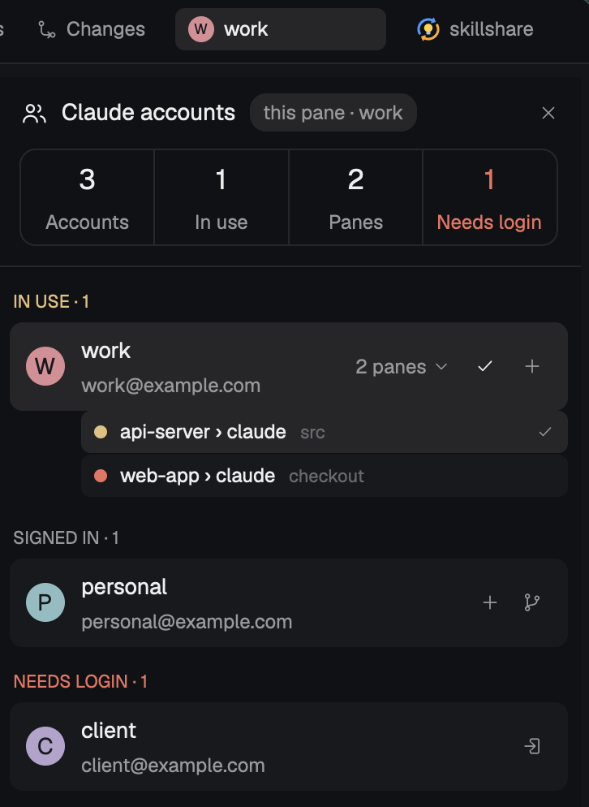

# Claude Code accounts

A tab-bar button and a side panel that show which Claude Code account each Herdr pane uses. The button carries the account's round avatar and name; clicking it slides open a 360 px panel with the accounts grouped as in use, signed in and needing a login, the panes that run Claude in each one, and a button to open a new tab or a fork of the session in another account, and a form that creates an account and opens its login.

**What you see:**

The panel is a column of 360 px (min 300, max 600) on the right of the active tab, hidden at first, on the `chrome` color. Top to bottom:

- **Header,** 44 px: the `users` icon (18 px, `foreground`), the title `Claude accounts` (semibold, UI font size + 1), a pill (`selected` background, 8 px side padding, 10 px radius, UI font size - 1, `muted`) that reads `this pane · <account>` or `no Claude here`, a 24 px `+` button (the `plus` icon, tooltip `Add account`) and a 24 px close button with the `close` icon.
- **Numbers,** a strip with a 1 px `border` and a 10 px radius on the `chrome` color. One 58 px tall cell each for `Accounts`, `In use` and `Panes`, and a fourth, `Needs login`, in the `blocked` color, only while at least one account has no login. The figure is semibold, UI font size + 4; the label is UI font size - 1.
- **Add form,** at the top of the list while it is open: a 1 px `border` box with an 8 px radius on `background`, 10 px padding and an 8 px gap. Top to bottom, the label `NEW ACCOUNT` (semibold, UI font size - 2, `muted`), a 30 px name box on `raised` with the keyboard in it (its border turns `blocked` on a bad name), the message in `blocked` when there is one, and `Cancel` and `Create` buttons, right-aligned, 28 px tall. `Create` reads `Creating…` while it runs.
- **Sections,** in this order, each with a label in semibold UI font size - 2 and a count: `IN USE · n` in `working`, `SIGNED IN · n` in `muted`, `NEEDS LOGIN · n` in `blocked`. An empty section is not drawn. The account of the focused pane leads its section.
- **One row per account,** at least 46 px tall, 8 px outside margin, 10 px inside padding, 10 px gap, 8 px radius, `selected` background for the focused pane's account and `background` for the others. From the left: a round 24 px avatar with the account's initial (bold, `background` color) on one of the theme's `ansi1` to `ansi6`, picked by the name so the same account always has the same color; the name (medium, `foreground`) over a line in `muted`, the e-mail or `not logged in`; the pane count as `2 panes` or `1 pane`, in a 64 px right-aligned slot; a 14 px `check` on the focused pane's account; the action buttons, 24 px squares with a 6 px radius and a 14 px icon.
- **Pane list,** under a row, indented 52 px: one 26 px line per pane with a status dot of 8 px, `<space> › <tab>` (medium) and the folder's name in `dim` (the pane's title when it has no folder), and a 12 px `check` on the focused pane. The account of the focused pane starts open.
- **Footer,** separated by a 1 px `border`: the `info` icon and `A running process keeps its account. Switching opens a new process.`, and under it an `Add account` button (28 px, `raised` background, 1 px `border`).
- **Error line,** above the footer only when the CLI failed, in `ansi1`.

The button is a 140 px block in the tab bar's row, on `chrome` with a 1 px `border` at the bottom. Inside it a 26 px control (6 px radius, 12 px text, 16 px avatar) shows the focused pane's account name next to its avatar, or the `users` icon and `Accounts` when the focused pane does not run a local Claude. While the panel is open the control has the `selected` background and `foreground` text; otherwise `chrome` and `muted`. Its tooltip is `<account>: <state>`, or the error.

The popup, opened by `ctrl-shift-a`, is the same header, sections and rows in a 340 px wide window, with no numbers strip and no footer, and an `Add account…` item (40 px, the `plus` icon) after the last row. Its height is 60 px, plus 26 per section, 50 per account and 40 for that item (plus 24 with an error line), up to 480; past that it scrolls. `Add account…` and the header's `+` replace it with a 340 x 230 popup of the same header and the form alone (role `add`). The pane list does not expand there: the pane count has a tooltip with one line per pane.

An optional chip, 160 px wide, can sit in any bar: 26 px tall, `surface` background, 1 px `border`, 13 px radius, a 20 px avatar, the account's name (13 px, semibold) and a 12 px `chevron-down`. It reads `no Claude` when the focused pane is not Claude, `...` while the account is not known yet and `?` on an error. Clicking it opens the popup.

**How it behaves:**

Every account is in one of four states, always written in words as well as in color:

| State                  | When                                                  | Row text                    |
| ---------------------- | ----------------------------------------------------- | --------------------------- |
| `in use · N panes`     | a Claude process of this computer runs in the account | `in use · 1 pane` and so on |
| `in use · needs login` | the same, but the account has no login                | in `blocked`                |
| `signed in`            | it has a login and no pane uses it                    | the e-mail                  |
| `needs login`          | it has no login and no pane uses it                   | `not logged in`             |

A pane counts as Claude when its foreground process is named `claude`, or when it is a `cc-accounts` script followed by `run` (the wrapper). A pane of another machine is left out. The pane's status dot uses the agent's status: `working`, `blocked`, `done` or `idle`, each in the theme's color of that name, and `dim` when the pane has none.

- **Reading.** One copy reads for all. The button, the panel, the chip and the popup are separate copies of the mod. A read runs `cc-accounts ls --json`, then one `cc-accounts which <pid>...` for every Claude pane and the focused one, and shares the answer through `setShared("cc-accounts.data")`, with a 15 second lock in `cc-accounts.lock` so only one copy runs the commands. A read starts when the focused pane or the set of Claude panes changes, and a 30 second timer reads again. A hidden panel runs nothing and reads as soon as it is shown. In `herdr-app check` nothing runs.
- **Buttons.** `plus` (tooltip `New tab`) runs `tab.new` with the argv `<cli> run <account>`. `fork` (tooltip `Continue here in a fork`) appears when the focused pane has a live session, the account is another one and it has a login; it runs `terminal.open` with `place: "right"`, the session's folder and the argv `<cli> run <account> --resume <session id> --fork-session`. An account that needs a login has only `log-in` (tooltip `Open a tab and run /login`), which runs `tab.new` with `name: "<account> login"`, the argv `<cli> run <account>`, `task: "/login"` and `focus: true`. No shell is involved: commands go as argv lists.
- **Add form.** The header's `+`, the footer's `Add account` and the popup's `Add account…` open it (a second click only moves the keyboard back to the name box). The name is checked on every keystroke with `nameProblem` of `model.js`, the rule the CLI uses: `^[a-z0-9][a-z0-9-]*$`, not `default`, not the default account's display name and not an existing account; the message shows under the box in `blocked`, and Create is refused while there is one. Enter in the box creates, Esc and `Cancel` close the form and run nothing. `Create` runs the CLI's `add <name>` (the CLI the mod resolved for reads, with the same fallback), shows `Creating…`, and on a non-zero exit keeps the first line of the error, at most 120 characters, in the form. On success it runs `tab.new` with `name: "<name> login"`, argv `<cli> run <name>`, `task: "/login"`, `focus: true`, reads the list again, and closes the form (in the add popup, the popup). In demo mode it runs nothing and shows `demo mode`.
- **Pane count.** In the panel it is a button with a `chevron-right` or `chevron-down` that opens or closes the pane list, saved per account in `localStorage` under `cc-accounts.open`. Clicking a pane runs `space.select`, `tab.select` and `pane.focus`, in that order.
- **Button.** Clicking it runs `layout.toggle` on the node `cc-accounts-panel`. The panel's close button runs `layout.hide` on it.
- **Demo mode.** `cc-accounts demo on` makes `ls --json` answer `{"demo": true, "accounts": [...]}` with three sample accounts. The mod then draws sample panes and ignores the real ones, and a click does nothing. `cc-accounts demo off` ends it.

**Built from:**

- `mod.json`: `{ "place": "none", "title": "Claude Code accounts", "overlay": { "kind": "popup", "width": 340, "height": 300 } }`. Herdr docks nothing by itself; the layout and the key place it.
- `main.js` exports a `View` with the role in `props().role`: `toggle`, `panel`, `chip`, `add` (the small popup with the form), or `menu` (the popup, which is also what `mod.open` delivers). `props().form` set to `"open"` starts a block with the form open. `model.js` holds what the mod decides without Herdr (which panes are Claude, the sections, the counts, the popup's height, the demo data, the name rule, the login tab). `cli.js` imports the name rule from `model.js`, so the folder stays self-contained.
- `keys.json`: `{ "global": { "ctrl-shift-a": "mod.open:cc-accounts" } }`, merged into the person's keys.
- Layout nodes, which the person's layout needs for the button and the panel: a block `{ "id": "cc-accounts-toggle", "type": "block", "size": { "px": 140 }, "content": { "mod": "cc-accounts", "props": { "role": "toggle" } } }` in the row that holds the `tabs` block, and a column `{ "id": "cc-accounts-panel", "type": "column", "hidden": true, "size": { "px": 360 }, "min": 300, "max": 600, "children": [{ "id": "cc-accounts", "type": "block", "content": { "mod": "cc-accounts", "props": { "role": "panel" } } }] }` right after the `{ "content": { "tab": "active" } }` block in its row. Without them the popup still works.
- Icons: nine SVGs in `icons/` (`users`, `plus`, `fork`, `log-in`, `info`, `close`, `check`, `chevron-right`, `chevron-down`), 24 x 24 viewBox, stroke `currentColor`, width 1.5, loaded with `svg("mods/cc-accounts/icons/<name>.svg")` and tinted with the text color.
- Modules: `gpui-kit` (`View`, `div`, `svg`), `gpui-base` (`v_flex`, `h_flex`, `InputState`, `Input`) and `herdr` (`exec`, `terminals`, `panes`, `spaces`, `focused`, `run`, `props`, `openOverlay`, `closeOverlay`, `checking`, `theme`, `settings`, `home`, `appHome`, `readTextFile`, `layout`, `shared`, `setShared`). Theme tokens: `chrome`, `surface`, `raised`, `background`, `foreground`, `muted`, `dim`, `border`, `hover`, `selected`, `working`, `blocked`, `done`, `idle`, `ansi1` to `ansi6`.
- The CLI, `cc-accounts`, a Node script in this same folder (`cli.js` is its code). The mod runs it by `appHome() + "/mods/cc-accounts/cc-accounts"` and falls back to `cc-accounts` on the `PATH` when that file cannot start; the one that worked is used for `run`. Its commands: `ls [--json]`, `add`, `sync`, `run`, `which`, `demo`. The panel's Create is the only thing the mod runs that writes: `add <name>`, which creates `~/.claude-accounts/<name>`.
- Programs the mod runs: the CLI above, which runs `ps -E` and `pgrep -P` and, on macOS, `security find-generic-password -s <service> -a <user>` (only its exit code; never with `-w` or `-g`); and `pgrep -P <pid>` from the mod itself. Files it reads outside its folder: `~/.claude`, `~/.claude.json`, `~/.claude-accounts/*/.claude.json` and `~/.claude*/sessions/<pid>.json` (through `readTextFile`). The CLI writes under `~/.claude-accounts/`. The network is not used.

**Watch out:**

- **Tell the person before adding it:** the mod runs programs (`exec` of its own CLI, including `add <name>`, which creates a folder under `~/.claude-accounts`, plus `ps`, `pgrep`, `security find-generic-password` without reading a value) and reads files outside its folder (`~/.claude`, `~/.claude.json`, `~/.claude-accounts`, the sessions of Claude). It never reads a credential, a token or a Keychain value.
- macOS is the supported system: `which` reads a process environment with `ps -E`, which has that form there; elsewhere it answers `unknown`.
- Render must not change shared state. Work that writes it starts after the render ends (`cx.spawn` runs its body up to the first `await` at once, so it sleeps for a tick first).
- Never keep a `cx` for later; every callback gets its own. No `setTimeout` or `setInterval`: use `cx.timer.every`. `init()` runs for real in `herdr-app check`, so guard `exec` and timers with `checking()`.
- An overlay cannot resize after it opens, so the popup's height is computed before `openOverlay`.
- The popup freezes the account and session of the pane it was opened from; the panel and the button follow the focused pane.
- The pane's pid can be the wrapper `cc-accounts run`, in front of Claude, because Node cannot `exec`. The account is read from the wrapper's `claude` child, never from its arguments, and the session file is looked up under the pid and its children.
- `signed in` only means that a Keychain item or a `.credentials.json` exists. An expired login still reads `signed in`.
- `task: "/login"` on the login tab is not verified in Herdr itself: Herdr detects agents by process and the pane runs the `cc-accounts run` wrapper in front of `claude`. The `log-in` tooltip keeps saying `Open a tab and run /login`, so the person knows what to type if the first message does not arrive.
- The add popup's 230 px was estimated, not measured; a message of two lines still fits.
- The button's 140 px was estimated: about twelve characters of a name fit before the ellipsis.
- A pane on another machine is not listed, and the account of a Claude that runs there is not known.
- Herdr's own layouts (`main`, `terminals`, `win98`) are replaced on every start, so put the two layout nodes in a layout of your own.
- Herdr writes `jsconfig.json` and `gpui-kit.d.ts` into this folder when it loads the mod. They are not part of it.

**Done when:**

- `herdr-app check mods/cc-accounts` exits 0.
- With `cc-accounts demo on`, `cc-accounts ls --json` prints `"demo": true` and the accounts `personal`, `client` and `work`, all with `@example.com` e-mails, and prints nothing of the real machine.
- In demo mode the open panel shows `Claude accounts` with the pill `this pane · work`, the numbers 3, 1, 2 and 1 (`Accounts`, `In use`, `Panes`, `Needs login`), the sections `IN USE · 1` (`work`, `2 panes`, a `working` dot on `api-server › claude` and a `blocked` dot on `web-app › claude`), `SIGNED IN · 1` (`personal`) and `NEEDS LOGIN · 1` (`client`, with only the `log-in` button).
- Clicking the button toggles the panel; the panel's close button hides it; `ctrl-shift-a` opens the popup with the same rows and no numbers.
- With a real Claude open in an account, its row moves to `IN USE` and counts the pane, and `cc-accounts which <pid>` prints that account.
- `plus` opens a tab running `cc-accounts run <account>`; `fork` opens a pane to the right that resumes the session with `--fork-session`; `log-in` opens a tab `<account> login` with `/login` as its first message.
- The header's `+` opens the add form with the keyboard in the name box; `Bad Name`, `default`, the default account's name and an existing account's name each show their message in `blocked` and `Create` runs nothing; Esc closes the form; a valid name runs `cc-accounts add <name>`, shows `Creating…`, opens the `<name> login` tab and lists the new account. In demo mode `Create` says `demo mode` and runs nothing.
- `herdr-app check` passes for the `panel` role with `props.form` set to `"open"` and for the `add` role.
- With the CLI's file removed from the folder and not on the `PATH`, the panel shows the error line `cc-accounts is not on PATH` and the button's tooltip shows it too.
